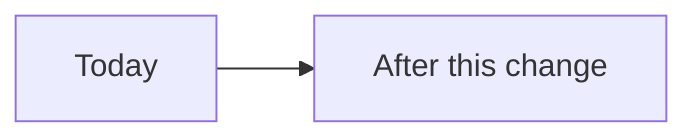

# Plan format

Plans are reviewed in a browser by the plan-review hook. It renders this markdown as a page of
task cards. Write in plain English for a reviewer who knows the codebase but not the details of this
change: they should understand *why* each task exists before *how* it is built. No padding.

## Skeleton

````markdown
# <Title: what this change does>

## Context
The problem, what prompted it, and what changes after this plan, in 150 words or fewer.
Add a diagram when there is a flow or structure to show.



## Tasks

### T1. <Short imperative title>
labels: blast=file · undo=easy · kind=code · size=S · deps=T0 · files=src/a.py, tests/test_a.py

**Why:** The problem this task solves, in prose: what is missing or broken today, and what would
go wrong without it. Two to four sentences.

**How:** The approach, in a short paragraph: which piece of code changes and the shape of the
change, explained as a story rather than a checklist. Then, if useful, a few bullets for
specifics a reviewer may want to check (names, edge cases, where it hooks in).

### T2. ...

## Verification
How we will know it works.

## Replies
- c1: Answer to the reviewer's comment c1.
- c2 (updated T2): What changed in T2 because of comment c2.
````

## Rules

- **Context** — 150 words max outside diagrams. Use `mermaid` blocks for flows, sequences, and structure.
- **Tasks** — every task is a `### Tn. Title` heading inside `## Tasks`, numbered `T0`, `T1`, …
  Keep IDs stable across revisions: never renumber; a dropped task's ID is not reused.
- **Labels line** — directly under the task heading, `key=value` pairs separated by `·`:

  | Key | Values | Meaning |
  |---|---|---|
  | `blast` | `file` · `module` · `packages` · `prod` | How far a mistake spreads: one file, one module, several packages or code that depends on it, production / other repos / shared infra |
  | `undo` | `easy` · `hard` | Whether the change is cheap to revert (`hard`: migrations, published releases, deletions, external side effects) |
  | `kind` | free text, e.g. `code`, `test`, `docs`, `config`, `infra`, `spike` | |
  | `size` | `S` · `M` · `L` | |
  | `deps` | task IDs, comma-separated | |
  | `files` | paths, comma-separated | |

  `blast` and `undo` are required; the others are optional.
- **Task description** — 250 words max. Always a `**Why:**` paragraph first, then `**How:**`.
  Lead with prose; bullets supplement it, they don't replace it. A reviewer who reads only the
  Why should know whether the task deserves to exist.
- **Other sections** — any other `## Section` (Design, Out of scope, Verification…) is shown as a
  collapsible panel. Keep them short too.

## Answering review comments

After a review round you receive the reviewer's comments, each with an ID (`c1`, `c2`, …) and the
card it is on. Then:

1. Answer **every** listed comment in `## Replies`, one bullet per comment: `- cN: answer`.
2. Change a task only when the comment requires it, and say so: `- cN (updated T2): what changed`.
   A question gets an answer, not a rewrite.
3. Each round, `## Replies` holds only that round's replies; earlier ones are already kept in the
   threads. The section is removed from the plan when it is approved.
