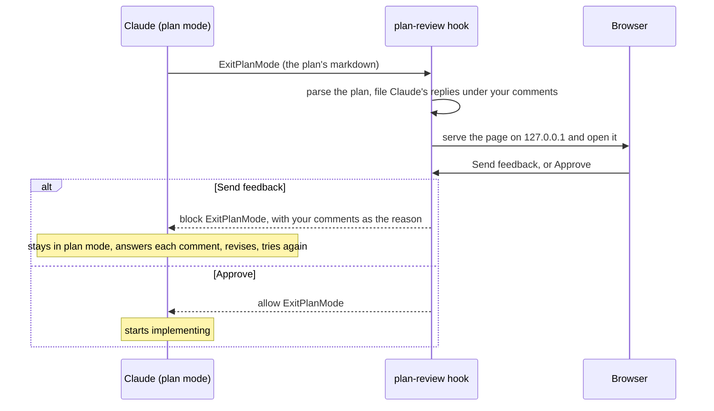

# plan-review

Review Claude Code's plans in your browser instead of the terminal. Each plan opens as a page:
a short context section with diagrams, a board of task cards, and a comment box on every card,
decision and question. You can send feedback and let Claude keep planning, or approve so it
starts implementing. Claude answers each comment in a thread under it, like a pull request
discussion.

## Why it exists

In plan mode, Claude writes a plan and asks for approval. The terminal offers one free-text box
for the whole plan, so reviewing a long plan has three problems:

- **No pointing.** You can't attach a comment to one task. You end up writing "about step 4…" and
  hoping the reference survives the next revision.
- **No conversation.** When Claude revises, your question and its answer are gone. Often the task
  is rewritten when all you wanted was an answer.
- **No overview.** A 200-line markdown plan hides what matters: which steps are risky, which
  touch production, which are hard to undo, and what changed since last round.

plan-review keeps Claude's normal plan-mode workflow and replaces only the review step.

## What you see

- **Context**: the problem and the outcome, kept short, with Mermaid diagrams rendered in the page.
- **Task cards**, one per task. Each shows:
  - a **blast-radius** icon: candle (one file), fire (one module), explosion (several packages or
    code that depends on them), mushroom cloud (production, other repos, shared infrastructure);
  - *hard to undo* when it applies;
  - labels such as kind, size and dependencies;
  - *updated* or *Claude replied* when something changed since your last round.
- **A task's details**: click a card to open the Why and How, the files it touches, a diff
  against the previous round, and the comment threads.
- **Decisions and questions**: each `D1`, `Q1`… bullet gets its own comment box.
- **The footer**: an overall-comment box, **Send feedback & continue planning**, **Approve**,
  and **Use terminal instead**.

Each comment can carry a verdict: ok, question, concern or blocker. Press Enter to add a comment,
or Shift+Enter for a new line. Unsent comments are saved as you type, so reloading the page loses
nothing.

## How it works



1. **Claude writes the plan in a fixed markdown format** ([FORMAT.md](FORMAT.md)). A line in your
   global `CLAUDE.md` tells it to. Claude never writes HTML; the code renders the page.
2. **A `PreToolUse` hook on `ExitPlanMode`** runs when Claude asks for approval. It parses the
   plan, serves the page on `127.0.0.1` behind a random token, opens your browser, and waits.
3. **Send feedback** blocks `ExitPlanMode`. Claude receives your open comments, each with an ID
   (`c1`, `c2`…), stays in plan mode, and answers every one in a `## Replies` section. It changes a
   task only when a comment calls for it. On its next attempt the page shows its answers under your
   comments, and marks the cards that changed.
4. **Approve** lets `ExitPlanMode` through, and Claude starts implementing. Comments you leave while
   approving are meant to travel as reviewer notes, but see Known issues.
5. **It never blocks you.** If anything goes wrong, the hook steps aside and Claude Code shows its
   usual approval prompt. That covers a crash, closing the tab (detected when the page stops
   checking in for 3 minutes), a timeout, or clicking **Use terminal instead**.

The code follows a functional core with an I/O shell:
- **Pure logic:** `parse.py` (markdown to plan, plus the format check), `threads.py` (comments,
  rounds, diffs), `decision.py` (what goes back to Claude) and `view.py` (the page's data).
- **I/O:** `hook.py` (the entry point) and `server.py` (the local web server).
- **The page:** plain JavaScript in `plan_review/static/`, with marked, DOMPurify and Mermaid
  bundled in the repo, so it works without network access.

Each plan's state lives in `.state/<plan-file-name>/`:
- `state.json`: the comment threads.
- `round-N.md`: every version of the plan.
- `draft.json`: unsent comments.

Errors go to `.state/hook.log`.

## Install

You need [uv](https://docs.astral.sh/uv/) and Claude Code. The examples assume the repo lives at
`~/Personal/plan-review`; adjust the paths if yours is elsewhere.

1. **Set up the environment:**

   ```bash
   cd ~/Personal/plan-review && uv sync
   ```

2. **Try the page without Claude** (optional). This plays a scripted first round, then opens round 2,
   with Claude's replies, in your browser:

   ```bash
   uv run python -m plan_review.demo
   ```

3. **Register the hook.** In `~/.claude/settings.json`, add this entry to the `hooks.PreToolUse`
   list (create the list if it doesn't exist):

   ```json
   {
     "matcher": "ExitPlanMode",
     "hooks": [{
       "type": "command",
       "command": "uv run --quiet --frozen --project ~/Personal/plan-review python -m plan_review.hook",
       "timeout": 3600
     }]
   }
   ```

   The 3600-second timeout gives you an hour to review. Claude Code's default for hooks is 10
   minutes.

4. **Tell Claude the plan format.** Add this to `~/.claude/CLAUDE.md`:

   ```markdown
   ## Plans

   When writing a plan file, follow `~/Personal/plan-review/FORMAT.md`. A hook renders plans as
   task cards for review; answer every review comment (`c1`, `c2`…) in the plan's `## Replies`.
   ```

5. **Check it.** Ask Claude to plan something small in plan mode. When it asks for approval, the
   page should open in your browser. If the usual terminal prompt appears instead, run `/hooks`
   or start a new session, then check `.state/hook.log`.

Add the hook yourself: Claude Code's auto mode won't let Claude edit its own hook settings.

## Settings

Environment variables, read by the hook:

| Variable | Default | What it does |
|---|---|---|
| `PLAN_REVIEW_TIMEOUT` | `3500` | Seconds before giving up. Keep it under the hook's `timeout`. |
| `PLAN_REVIEW_LOAD_TIMEOUT` | `120` | Seconds for the page to first load. |
| `PLAN_REVIEW_HEARTBEAT_TIMEOUT` | `180` | Seconds without a check-in from the page before assuming the tab was closed. |
| `PLAN_REVIEW_STATE_DIR` | `./.state` | Where state and the log go. |
| `PLAN_REVIEW_NO_BROWSER` | unset | Don't open a browser; the page URL is printed to stderr. |

## Known issues

- **Unsent comments survive "Use terminal instead".** The draft isn't cleared on that path, so
  the next round shows them again as unsent. Sending them creates duplicates.
- **Approval edits don't reach Claude.** On approval the hook passes an edited copy of the plan: no
  `## Replies`, plus any comments you left as reviewer notes. Claude Code reads the plan file
  instead, so the replies stay and the notes are lost. Until this is fixed, send last comments with
  **Send feedback** rather than with **Approve**.
- **One plan file per session.** If you plan a second, unrelated change in the same session, it
  overwrites the plan file and continues the first one's review history and round numbers.

## Development

```bash
uv run pytest
```

The tests cover the parser, threads, the feedback sent to Claude, the hook's fallback paths, and
the real HTTP server (token, Host header and path checks).
