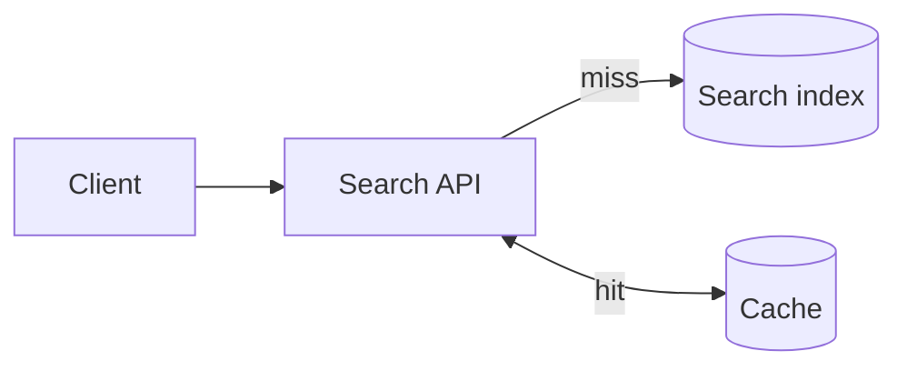

# Cache search results in the API

## Context
Search takes ~800 ms per request and most queries repeat within minutes. Caching results for a short time should cut typical latency to under 50 ms.

## Tasks

### T1. Add a cache client
labels: blast=module · undo=easy · kind=code · size=S · files=api/cache.py, tests/test_cache.py

**Why:** The search endpoint has nowhere to keep results between requests, so every repeated query pays the full 800 ms. A small client keeps the cache details (connection, expiry, key format) out of the endpoint code and makes them easy to test on their own.

**How:** A thin wrapper over Redis with `get`/`set` and a 2-minute expiry, configurable per environment. The endpoint only ever asks "do you have this query?" and "remember this result".
- Keys are a hash of the normalised query, so `Cats ` and `cats` share an entry.
- A Redis outage returns a miss rather than an error: search still works, just slower.

### T2. Use the cache in the search endpoint
labels: blast=packages · undo=easy · kind=code · size=M · deps=T1 · files=api/search.py

**Why:** The client from T1 does nothing until search uses it. This is the change users actually feel: repeated queries return from the cache instead of the index.

**How:** The endpoint checks the cache first and only queries the index on a miss, storing the result afterwards. Other services call this endpoint, so the response shape must not change; the cache is invisible to callers.
- A request header can bypass the cache, for debugging.

### T3. Provision Redis in staging and production
labels: blast=prod · undo=hard · kind=infra · size=M · files=infra/redis.tf

**Why:** The cache needs somewhere to live in staging and production. Without it, T2 falls back to a miss on every request and nothing improves.

**How:** One small Redis instance per environment, defined in Terraform next to the API's other resources. Removing it later means a migration window, which is why this is the one step that's hard to undo.

### T4. Document the cache
labels: blast=file · undo=easy · kind=docs · size=S · deps=T2 · files=docs/search.md

**Why:** Cached results can look like stale data to someone debugging search. They need to know caching exists and how to turn it off.

**How:** A short section in the search docs: how long results are cached, and the header that bypasses the cache.

## Verification
- Unit tests for the cache client.
- Load test in staging: p50 latency under 50 ms for repeated queries.

## Out of scope
Caching autocomplete; invalidating the cache when the index is rebuilt.

## Replies
- c1 (updated T1): Agreed, 5 minutes was a guess. It's now 2 minutes and configurable, so we can tune it from the staging load test.
- c2: Yes. T3 is the only step that's hard to undo, so it waits for your approval of the staging numbers before production.
- c3: The cache key includes the user's tenant ID, so results never cross tenants.
